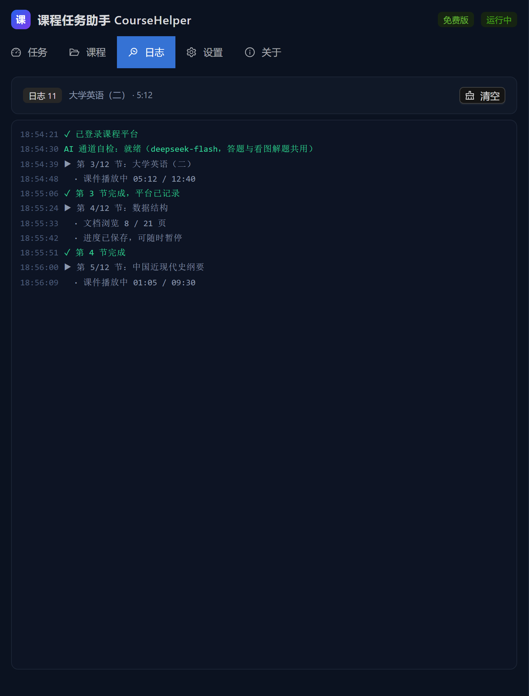

# 课程任务助手 CourseHelper

高校在线课程任务自动化桌面客户端。**完全免费、无需激活码**。单窗口内嵌浏览器，无需另装 Chrome/Edge，支持断点续跑、实时日志。

> ⚠️ 本工具仅供学习与技术研究使用，请遵守所在学校与平台的使用规则，风险自负。

**[项目主页](https://ling19-yi.github.io/coursehelper/)** — 图文介绍、更新日志、功能演示



## 功能

- **内嵌浏览器**：Electron WebContentsView + CDP 驱动，右侧即真实学习通页面，可随时观察
- **自动播放**：视频章节按课程进度播放（保持平台 1x 倍速，不篡改倍速），300ms 页内守护 + 鼠标抖动防暂停
- **文档任务点**：PDF/文档自动滚动到底并等待平台确认
- **断点续跑**：每门课进度落盘，重开从上次未完成章节继续；**平台已手动刷过的章节会自动跳过**；平台整课已完成的课程直接跳过
- **章节测验（选填）**：配置多模态 API Key 后可辅助作答图片题干 / 字体替换的题目，否则跳过并记录日志
- **暂停 / 继续 / 停止**：随时可控，实时日志滚动

## 下载安装

1. 从 [GitHub Releases](https://github.com/Ling19-YI/coursehelper/releases/latest) 下载 `CourseHelper-Setup-2.1.4.exe`（约 110 MB，Windows 10/11 x64）。GitHub 访问不畅时，改从 [GitCode Releases](https://gitcode.com/2603_95808828/coursehelp/-/releases) 下载同名文件——两个平台的产物与版本完全一致
2. 首次运行 Windows SmartScreen 可能提示「已保护你的电脑」——这是**未购买代码签名证书**导致的正常现象，点「更多信息 → 仍要运行」即可
3. 安装后**直接使用，无需激活码、无需登录**

## 使用步骤

1. 「设置」页填写平台账号密码（本机加密存储）→ 保存
2. 「课程」页点击「刷新课程」→ 勾选要处理的课程
3. 「任务」页点击「开始运行」，在「日志」页观察进度
4. 中途可暂停/继续/停止；默认开启断点续跑

## 支持作者（自愿）

软件完全免费。如果它帮你省下了时间，欢迎在「关于」页扫码请作者喝杯奶茶 —— **不支持也完全不影响使用**。

## 开发

```bash
npm install
npm run dev        # vite + esbuild watch + electron 开发循环
npm run build      # esbuild(main/preload) + vite(renderer)
npm run typecheck  # tsc --noEmit
npm run dist       # electron-builder 打 NSIS 安装包 → release/
```

验证脚本（需先 `npm run build`）：

```bash
npm run smoke                # 主进程/preload/IPC 冒烟
node scripts/verify-ui.mjs   # 首屏直达任务页 + 关于页收款码 + 真实拉课程列表 → 逐页截图
node scripts/verify-run.mjs  # UI 启动任务 → 内嵌视图打开超星 → 停止
node scripts/verify-installer.mjs # 静默安装 → 启动 → 静默卸载
```

## 目录结构

```
src/
  main/        主进程：窗口、IPC、会话(CDP)、存储
  main/engine/ 自动化引擎（事件驱动，与 UI 解耦）
  preload/     contextBridge 白名单（window.ch）
  renderer/    React + AntD 深色 UI
  shared/      主/渲染共享类型与 API 契约
scripts/       构建与验证脚本
promo/         宣传视频流水线（HTML 渲染 + TTS 配音 + ffmpeg 合成）
```

## 许可

私有项目，未授权禁止分发。
